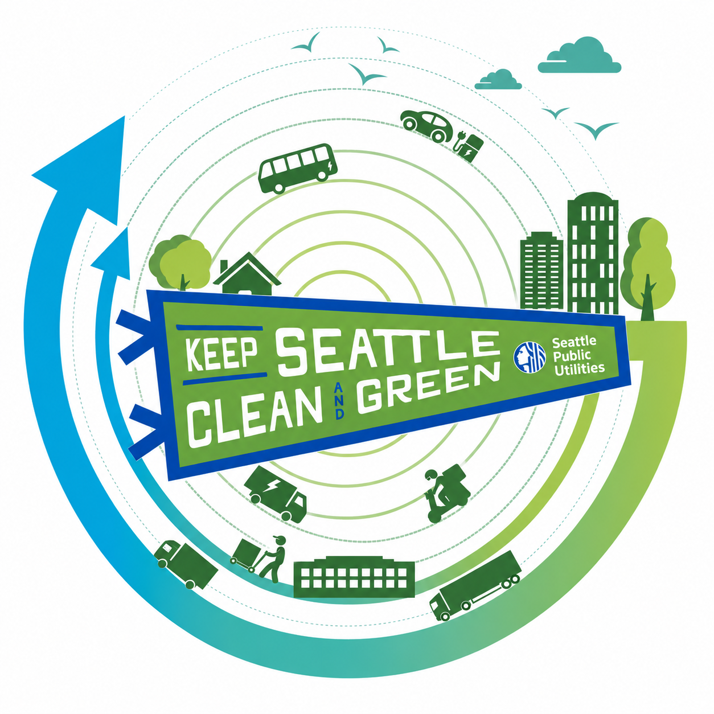

<style>
body {
  font-family: Arial, Helvetica, sans-serif;
  font-size: 16px;
  color: #2f2f2f;
  line-height: 1.6;
}

/* Main section headings */
h2 {
  background-color: #dcefe1;
  color: #244a35;
  padding: 7px 12px;
  border-radius: 4px;
  margin-top: 25px;
  font-size: 19px !important;
  font-weight: 600;
}

/* Smaller subsection headings */
h3 {
  background-color: #edf7ef;
  color: #315b40;
  padding: 6px 10px;
  border-radius: 4px;
  font-size: 17px !important;
  font-weight: 600;
}

/* Special darker Executive Summary */
.executive-summary {
  background-color: #9fc5a8;
  color: #183b27;
  padding: 14px 18px;
  border-radius: 5px;
  font-size: 1.45em;
  font-weight: 600;
  margin-top: 25px;
  margin-bottom: 15px;
}

/* Main project title */
h1.title {
  font-family: "Segoe UI", Arial, sans-serif;
  font-size: 28px !important;
  font-weight: 600;
  color: #233B5D !important;
  letter-spacing: -0.3px;
}

/* Subtitle under main title */
p.subtitle {
  font-family: "Segoe UI", Arial, sans-serif;
  font-size: 18px !important;
  color: #4f5f70;
}

/* Author name */
#quarto-document-content #title-block-header .quarto-title-meta-contents p {
  font-family: "Segoe Script", "Brush Script MT", cursive;
  font-size: 18px;
  color: red !important;
}

</style>

## Introduction

::: {.columns}

::: {.column width="70%"}

This project covers the electricity and transit energy data for evaluating public transit agencies and their carbon emissions. Additional Tennessee electricity inputs has been obtain from the US Energy Information Administration (EIA). The transit data cover 2025, while the electricity data cover 2024.

:::

::: {.column width="30%"}

{width=180}

:::

:::


## Data Acquisition and Preparation


### Task 1a: Data Acquisition - State Electricity Profiles

```{r}
#| label: setup-mp02
#| message: false
#| warning: false

library(tidyverse)
library(stringr)
library(httr2)
library(rvest)
library(readxl)
library(fs)

fs::dir_create("data/mp02", recurse = TRUE)
```

```{r}
#| label: acquire-eia
#| message: false
#| warning: false

# Instructor-provided EIA electricity profile function.
get_eia_sep <- function(state, abbr) {
  library(tidyverse)
  library(stringr)
  library(httr2)
  library(rvest)
  library(fs)

  state_formatted <- str_to_lower(state) |>
    str_replace_all("\\s", "")

  dir_name <- fs::path("data", "mp02")
  file_name <- fs::path(dir_name, state_formatted)

  fs::dir_create(dir_name, recurse = TRUE)

  if (!fs::file_exists(file_name)) {
    BASE_URL <- "https://www.eia.gov"

    RESPONSE <- request(BASE_URL) |>
      req_url_path(
        "electricity",
        "state",
        state_formatted
      ) |>
      req_headers(
        `User-Agent` = "Mozilla/5.0 (Macintosh; Intel Mac OS X 10.15; rv:149.0) Gecko/20100101 Firefox/149.0"
      ) |>
      req_retry(max_tries = 4) |>
      req_perform(file_name)

    resp_check_status(RESPONSE)
  }

  TABLE <- read_html(file_name) |>
    html_element("table") |>
    html_table() |>
    mutate(Item = str_to_lower(Item))

  if ("U.S. rank" %in% colnames(TABLE)) {
    TABLE <- TABLE |>
      rename(Rank = `U.S. rank`)
  }

  CO2_MWh <- TABLE |>
    filter(Item == "carbon dioxide (lbs/mwh)") |>
    pull(Value) |>
    str_replace_all(",", "") |>
    as.numeric()

  PRIMARY <- TABLE |>
    filter(Item == "primary energy source") |>
    pull(Rank)

  RATE <- TABLE |>
    filter(Item == "average retail price (cents/kwh)") |>
    pull(Value) |>
    as.numeric()

  GENERATION_MWh <- TABLE |>
    filter(Item == "net generation (megawatthours)") |>
    pull(Value) |>
    str_replace_all(",", "") |>
    as.numeric()

  data.frame(
    CO2_MWh = CO2_MWh,
    primary_source = PRIMARY,
    electricity_price_MWh = RATE * 10,
    generation_MWh = GENERATION_MWh,
    state = state,
    abbreviation = abbr
  )
}
# Collect all 50 states using the teacher's function.
EIA_SEP_REPORT <- map2(
  state.name,
  state.abb,
  get_eia_sep
) |>
  list_rbind()

nrow(EIA_SEP_REPORT)


```

### Tennessee generation source

I used this excel data [EIA Table 3.7 (Excel)](https://www.eia.gov/electricity/annual/xls/epa_03_07.xlsx) for utility-scale generation by state and sector. The same workbook is included in the [complete Electric Power Annual ZIP](https://www.eia.gov/electricity/annual/xls/epa.zip). Table 3.1.A is national and should not be used as Tennessee generation.

In the inspected 2025 edition of Table 3.7, Tennessee is row 46 and the 2024 All Sectors total is C46: **76,167 thousand MWh**, or approximately **76.167 million MWh (76.167 TWh)**. The code below finds the Tennessee row and 2024 column from their labels instead of fixing their positions.

This table supplies generation only. Carbon dioxide intensity, primary energy source, and retail electricity price continue to come from the [Tennessee Electricity Profile 2024](https://www.eia.gov/electricity/state/tennessee/index.php). The profile reports 76,166,766 MWh, consistent with the rounded generation table.

```{r}
#| label: acquire-tennessee-generation
#| message: false
#| warning: false

EIA_YEAR <- 2024L
EIA_GENERATION_URL <- "https://www.eia.gov/electricity/annual/xls/epa_03_07.xlsx"
EIA_GENERATION_FILE <- fs::path("data", "mp02", "epa_03_07.xlsx")

# Download workbook only.
if (!fs::file_exists(EIA_GENERATION_FILE)) {
  request(EIA_GENERATION_URL) |>
    req_headers(`User-Agent` = "Mozilla/5.0") |>
    req_retry(max_tries = 4) |>
    req_perform(path = EIA_GENERATION_FILE)
}

generation_raw <- read_excel(
  EIA_GENERATION_FILE,
  col_names = FALSE,
  col_types = "text",
  .name_repair = "minimal"
)

# Normalize line breaks and whitespace in the multi-row Excel headings.
generation_cells <- as.matrix(generation_raw)
generation_cells[is.na(generation_cells)] <- ""
generation_cells[] <- str_squish(generation_cells)

header_row <- which(str_detect(
  generation_cells[, 1], "Census Division.*State"
))
tennessee_row <- which(generation_cells[, 1] == "Tennessee")
if (length(header_row) != 1L || length(tennessee_row) != 1L) {
  stop("Expected one state heading and one Tennessee row in Table 3.7.")
}
year_columns <- which(
  generation_cells[header_row, ] == paste("Year", EIA_YEAR)
)
if (length(year_columns) == 0L) {
  stop("The requested reporting year is absent from Table 3.7.")
}

# The first year column belongs to the leftmost All Sectors group.
all_sector_col <- min(year_columns)
if (!any(generation_cells[seq_len(header_row), 2] == "All Sectors")) {
  stop("Unexpected layout: verify the All Sectors column group.")
}
if (!any(str_detect(generation_cells, fixed("Thousand Megawatthours")))) {
  stop("Unexpected generation units: inspect the workbook before converting.")
}
tn_generation_thousand_mwh <- parse_number(
  generation_cells[tennessee_row, all_sector_col]
)
stopifnot(
  is.finite(tn_generation_thousand_mwh),
  tn_generation_thousand_mwh > 0
)

TN_GENERATION <- tibble(
  state = "Tennessee",
  abbreviation = "TN",
  electricity_year = EIA_YEAR,
  generation_MWh = tn_generation_thousand_mwh * 1000,
  generation_source = EIA_GENERATION_URL,
  generation_coverage = "Utility-scale net generation, all sectors"
)
TN_GENERATION
```

### Task 1: Load the Electricity and Transit Datasets

```{r}
#| label: load-electricity-data
#| message: false
#| warning: false

stopifnot(
  nrow(EIA_SEP_REPORT) == 50L,
  !anyDuplicated(EIA_SEP_REPORT$abbreviation)
)

EIA_SEP_REPORT |>
  arrange(desc(generation_MWh))

# Supplementary comparison with Tennessee's 2024 ZIP data.

TN_GENERATION_CHECK <- EIA_SEP_REPORT |>
  filter(abbreviation == "TN") |>
  transmute(
    state,
    profile_generation_mwh = generation_MWh
  ) |>
  left_join(
    TN_GENERATION |>
      transmute(
        state,
        zip_generation_mwh = generation_MWh
      ),
    by = "state"
  ) |>
  mutate(
    difference_mwh =
      zip_generation_mwh - profile_generation_mwh
  )

stopifnot(
  nrow(TN_GENERATION_CHECK) == 1L,
  !is.na(TN_GENERATION_CHECK$difference_mwh),
  abs(TN_GENERATION_CHECK$difference_mwh) <= 500
)

TN_GENERATION_CHECK
```

I use the utility-scale total. Utility-scale solar is already included in Table 3.7. [Table 3.21](https://www.eia.gov/electricity/annual/xls/epa_03_21.xlsx) separately reports Tennessee's 2024 small-scale photovoltaic generation as 86 thousand MWh. Keep the utility-scale total for the present dataset; any expanded total should be explicitly labeled and checked for compatibility with the emissions measure. Do not add total photovoltaic generation to Table 3.7 because utility-scale solar is already included.

I use the utility-scale total without adding small-scale solar. Utility-scale solar is already included in Table 3.7.

### Task 1b: Data Acquisition - NTD Energy Usage
```{r}
#| label: acquire-ntd-energy
#| message: false
#| warning: false

# Instructor-provided NTD energy function.
load_ntd_energy <- function() {

  library(readxl)
  library(httr2)
  library(tidyverse)
  library(fs)

  DATA_DIR <- fs::path("data", "mp02")
  fs::dir_create(DATA_DIR, recurse = TRUE)

  NTD_ENERGY_FILE <- fs::path(
    DATA_DIR,
    "2025_ntd_energy.xlsx"
  )

  if (!fs::file_exists(NTD_ENERGY_FILE)) {
    request("https://www.transit.dot.gov/") |>
      req_url_path(
        "sites",
        "fta.dot.gov",
        "files",
        "2026-09",
        "2025 Energy Consumption_260806.xlsx"
      ) |>
      req_headers(
        `User-Agent` = "Mozilla/5.0 (Macintosh; Intel Mac OS X 10.15; rv:149.0) Gecko/20100101 Firefox/149.0"
      ) |>
      req_perform(NTD_ENERGY_FILE)
  }

  if (file.info(NTD_ENERGY_FILE)$size < 1e4) {
    stop(
      "The saved NTD Excel file is incomplete. ",
      "Replace it with the manually downloaded workbook."
    )
  }

  to_numeric_fill_0 <- function(x) {
    x <- if_else(x == "-", NA, x)
    replace_na(as.numeric(x), 0)
  }

  read_excel(NTD_ENERGY_FILE) |>
    select(
      -c(
        `Reporter Type`,
        `Reporting Module`,
        `Gallons of Other Fuel`,
        `Other Fuel Description`
      )
    ) |>
    mutate(
      across(
        -c(`Agency Name`, Mode, TOS),
        to_numeric_fill_0
      )
    ) |>
    group_by(`NTD ID`, Mode, `Agency Name`) |>
    summarize(
      across(where(is.numeric), sum),
      .groups = "keep"
    ) |>
    mutate(
      ENERGY = sum(c_across(where(is.numeric)))
    ) |>
    filter(ENERGY > 0) |>
    select(-ENERGY) |>
    ungroup()
}
```
```{r}
#| label: load-transit-energy
#| message: false
#| warning: false

NTD_ENERGY <- load_ntd_energy()
head(NTD_ENERGY)
```

### Task 1c: Data Acquisition - Service Provided
```{r}
#| label: acquire-ntd-service
#| message: false
#| warning: false

load_ntd_service <- function(){
  library(httr2)
  library(tidyverse)
  library(fs)
  
  # Create 'data/mp02' directory if not already present
  DATA_DIR <- fs::path("data", "mp02")
  fs::dir_create(DATA_DIR, recurse=TRUE)

  NTD_SERVICE_FILE <- fs::path(DATA_DIR, "2025_ntd_service.csv")

  if(!fs::file_exists(NTD_SERVICE_FILE)){
    library(httr2)
  
    request("https://data.transportation.gov/resource/4fir-qbim.csv") |>
      req_url_query(`$query`=paste(
        "SELECT  `_5_digit_ntd_id` AS `NTD_ID`", 
        "`max_agency` AS `AGENCY`",
        "`max_reporter_type` AS `reporter_type`",
        "`max_organization_type` AS `organization_type`",
        "`max_city` AS `city`",
        "`max_state` AS `state`",
        "`mode`",
        "`type_of_service`",
        "`max_primary_uza_code` as `uza_code`",
        "`max_primary_uza_name` as `uza_name`",
        "`max_primary_uza_area_sq_miles` as `uza_sq_miles`",
        "`max_primary_uza_population` as `uza_population`",
        "`max_service_area_sq_miles` as `service_area_sq_miles`",
        "`max_service_area_population` as `service_area_population`",
        "`questionable_record` as `flagged_likely_inaccurate`",
        "`sum_unlinked_passenger_trips_upt` as `total_upt`",
        "`sum_passenger_miles` WHERE caseless_one_of(`report_year`, '2025') limit 50000", 
        sep=",")) |>
      req_headers(
        `User-Agent` = "Mozilla/5.0 (Macintosh; Intel Mac OS X 10.15; rv:149.0) Gecko/20100101 Firefox/149.0") |> 
      req_perform(NTD_SERVICE_FILE)
  }
  
  if(file.info(NTD_SERVICE_FILE)$size < 1e4){
        cat("I was unable to download the NTD Service File. Please try again.\n")
        stop("Download failed. Please delete the corrupted file by running `unlink('data/mp02/2025_ntd_service.xlsx')` and try again.")
    }

  read_csv(NTD_SERVICE_FILE) |>
    mutate(flagged_likely_inaccurate = !is.na(flagged_likely_inaccurate))
}

NTD_SERVICE <- load_ntd_service()
head(NTD_SERVICE)
```


```{r}
#| label: inspect-source-data
#| include: false

# Inspect column types.
glimpse(EIA_SEP_REPORT)
glimpse(NTD_ENERGY)
glimpse(NTD_SERVICE)

# Inspect distributions and missing values.
summary(EIA_SEP_REPORT)
summary(NTD_ENERGY)
summary(NTD_SERVICE)

# Inspect mode codes and service types.
NTD_ENERGY |>
  count(Mode, sort = TRUE)

NTD_SERVICE |>
  count(mode, type_of_service, sort = TRUE)

NTD_SERVICE |>
  count(flagged_likely_inaccurate)
```


### Task 2: Data Cleaning and Preparation

```{r}
#| label: recode-transit-modes
#| message: false
#| warning: false

# Identify the original mode codes in both datasets.
NTD_ENERGY |>
  distinct(Mode) |>
  arrange(Mode)

NTD_SERVICE |>
  distinct(mode) |>
  arrange(mode)

# Use the same labels in both datasets.
expand_mode <- function(x) {
  dplyr::recode_values(
    x,
    "AR" ~ "Alaska Railroad",
    "CB" ~ "Commuter Bus",
    "CC" ~ "Cable Car",
    "CR" ~ "Commuter Rail",
    "DR" ~ "Demand Response",
    "DT" ~ "Demand Response Taxi",
    "FB" ~ "Ferryboat",
    "HR" ~ "Heavy Rail",
    "IP" ~ "Inclined Plane",
    "JT" ~ "Jitney",
    "LR" ~ "Light Rail",
    "MB" ~ "Bus",
    "MG" ~ "Monorail/Automated Guideway",
    "PB" ~ "Publico",
    "RB" ~ "Bus Rapid Transit",
    "SR" ~ "Streetcar Rail",
    "TB" ~ "Trolleybus",
    "TR" ~ "Aerial Tramway",
    "VP" ~ "Vanpool",
    "YR" ~ "Hybrid Rail",
    default = "Unknown"
  )
}

# Preserve the original codes for checking and later joins.
NTD_ENERGY <- NTD_ENERGY |>
  mutate(
    mode_code = if ("mode_code" %in% names(NTD_ENERGY)) {
      mode_code
    } else {
      as.character(Mode)
    },
    Mode = expand_mode(mode_code)
  )

NTD_SERVICE <- NTD_SERVICE |>
  mutate(
    mode_code = if ("mode_code" %in% names(NTD_SERVICE)) {
      mode_code
    } else {
      as.character(mode)
    },
    mode = expand_mode(mode_code)
  )

# Display code-to-name mappings found in the data.
bind_rows(
  NTD_ENERGY |> transmute(mode_code, mode_name = Mode),
  NTD_SERVICE |> transmute(mode_code, mode_name = mode)
) |>
  distinct() |>
  arrange(mode_code)

# Identify any codes that still need interpretation.
bind_rows(
  NTD_ENERGY |> transmute(mode_code, mode_name = Mode),
  NTD_SERVICE |> transmute(mode_code, mode_name = mode)
) |>
  filter(mode_name == "Unknown") |>
  distinct()
```

```{r}
#| label: clean-transit-energy
#| message: false
#| warning: false

transit_energy_clean <- NTD_ENERGY |>
  select(
    -matches("Description$", ignore.case = TRUE)
  ) |>
  rename(
    ntd_id = `NTD ID`,
    agency_name = `Agency Name`,
    mode = Mode
  ) |>
  mutate(
    ntd_id = str_pad(
      as.character(ntd_id),
      width = 5,
      side = "left",
      pad = "0"
    ),
    mode = as.character(mode)
  )

transit_energy_clean |>
  select(ntd_id, agency_name, mode) |>
  head(10)
```


```{r}
#| label: clean-electricity-data
#| message: false
#| warning: false

electricity_clean <- EIA_SEP_REPORT |>
  as_tibble() |>
  transmute(
    state,
    state_code = abbreviation,
    co2_lbs_per_mwh = CO2_MWh,
    primary_energy_source = primary_source,
    electricity_price_per_mwh = electricity_price_MWh,
    generation_mwh = generation_MWh
  )

electricity_clean |>
  arrange(desc(co2_lbs_per_mwh)) |>
  print(n = 10)
```
## Data Integration and Initial Exploration

### Task 3a: Initial Analysis of SEP Data

#### 3a.1: Which five states have the most expensive retail electricity?

```{r}
#| label: plot-expensive-electricity
#| fig-cap: "Five states with the highest average retail electricity prices."
#| message: false
#| warning: false

expensive_states <- EIA_SEP_REPORT |>
  slice_max(
    electricity_price_MWh,
    n = 5,
    with_ties = FALSE
  )

ggplot(
  expensive_states,
  aes(
    x = reorder(state, electricity_price_MWh),
    y = electricity_price_MWh
  )
) +
  geom_col(fill = "#315b40", width = 0.7) +
  coord_flip() +
  scale_y_continuous(
    labels = scales::label_dollar(),
    expand = expansion(mult = c(0, 0.08))
  ) +
  labs(
    x = NULL,
    y = "Average retail price ($ per MWh)",
    caption = "Source: EIA State Electricity Profiles."
  ) +
  theme_minimal(base_size = 12)
```

#### 3a.2: Which five states have the dirtiest electricity mix?

Let us first define 'dirtiest.' It means the most CO₂ emitted per MWh of electricity generated. Looking at these five states, a common thread emerges: Coal is highly used in these states, while Hawaii relies on petroleum. Each has its own pollution story but coal trumps the top four states.

```{r}
#| label: table-dirtiest-electricity
#| message: false
#| warning: false

dirty_states <- EIA_SEP_REPORT |>
  slice_max(CO2_MWh, n = 5, with_ties = FALSE) |>
  arrange(desc(CO2_MWh)) |>
  transmute(
    State = state,
    `Primary energy source` = primary_source,
    `CO2 emissions (lbs/MWh)` = CO2_MWh
  )

knitr::kable(
  dirty_states,
  format.args = list(big.mark = ","),
  caption = "Five states with the highest electricity CO₂ intensity."
)
```

#### 3a.3: What is the generation-weighted national CO₂ intensity?

```{r}
#| label: calculate-weighted-co2
#| include: false

stopifnot(
  all(is.finite(EIA_SEP_REPORT$CO2_MWh)),
  all(is.finite(EIA_SEP_REPORT$generation_MWh)),
  all(EIA_SEP_REPORT$generation_MWh > 0)
)

national_co2 <- with(
  EIA_SEP_REPORT,
  weighted.mean(CO2_MWh, w = generation_MWh)
)
```

Across the 50 states, electricity generation emits approximately **`r scales::number(national_co2, accuracy = 0.1, big.mark = ",")` pounds of CO₂ per MWh**. This average weights each state's emissions intensity by its annual net generation, so states producing more electricity contribute more to the result.

#### 3a.4: What are the three rarest primary energy sources?

Petroleum takes the smallest place at the table, leading only in Hawaii, while Hydroelectric power and wind follow. Interestingly, none of these states ranked among the nation’s ten most populous in 2025. (Source: U.S. Census Bureau, July 1, 2025 estimates.)

```{r}
#| label: table-rarest-primary-sources
#| message: false
#| warning: false

rare_sources <- EIA_SEP_REPORT |>
  count(primary_source, name = "states_using_source") |>
  arrange(states_using_source, primary_source) |>
  slice_head(n = 3)

rare_source_states <- EIA_SEP_REPORT |>
  inner_join(rare_sources, by = "primary_source") |>
  arrange(states_using_source, primary_source, state) |>
  transmute(
    `Primary energy source` = primary_source,
    `Number of states` = states_using_source,
    State = state,
    `Retail electricity price ($/MWh)` =
      scales::dollar(electricity_price_MWh, accuracy = 0.01)
  )

knitr::kable(
  rare_source_states,
  caption = "The three least common primary electricity sources and the states using them."
)
```

#### 3a.5: How many times cleaner is NY’s energy mix than that of Texas? 


```{r}
#| label: calculate-ny-texas-comparison
#| include: false

ny_co2 <- EIA_SEP_REPORT |>
  filter(abbreviation == "NY") |>
  pull(CO2_MWh)

texas_co2 <- EIA_SEP_REPORT |>
  filter(abbreviation == "TX") |>
  pull(CO2_MWh)

stopifnot(
  length(ny_co2) == 1L,
  length(texas_co2) == 1L,
  ny_co2 > 0,
  texas_co2 > 0
)

texas_ny_ratio <- texas_co2 / ny_co2
ny_reduction <- 1 - ny_co2 / texas_co2
```

Texas emits **`r scales::number(texas_ny_ratio, accuracy = 0.01)` times as much CO₂ per MWh as New York**. Equivalently, New York's electricity emissions intensity is **`r scales::percent(ny_reduction, accuracy = 0.1)` lower** than Texas's. For every MWh of electricity generated, New York releases 34.8% less CO₂ than Texas. On paper, NY state is greener than Texas, but there is a contrast in population density. 

Curiously, NY has less carbon emission by about 35%, and also about 35% less population than Texas. Using July 1, 2025 Census estimates—20,002,427 residents in New York and 31,709,821 in Texas—New York’s population was 36.9% smaller than Texas’s. 


### Task 3b: Initial Analysis of NTD Energy Data

#### 3b.3: What is the least commonly used fuel source?

**Liquefied natural gas (LNG) is used by just one transit agency** is the least commonly used fuel. These data show how rare LNG use is, but do not explain why agencies choose other options. Bunker fuel and kerosene have no recorded positive consumption.

```{r}
#| label: calculate-least-common-fuel
#| include: false

fuel_columns <- names(NTD_ENERGY)[
  str_detect(
    names(NTD_ENERGY),
    regex("^Gallons of |^Kilograms of Hydrogen$", ignore_case = TRUE)
  )
]

stopifnot(length(fuel_columns) > 0L)

fuel_use_long <- NTD_ENERGY |>
  select(`NTD ID`, all_of(fuel_columns)) |>
  pivot_longer(
    cols = all_of(fuel_columns),
    names_to = "fuel",
    values_to = "amount"
  ) |>
  mutate(
    fuel = str_remove(
      fuel,
      regex("^(Gallons|Kilograms) of ", ignore_case = TRUE)
    )
  )

# Retain zero-use fuel categories in the summary.
fuel_categories <- fuel_use_long |>
  distinct(fuel)

fuel_agency_counts <- fuel_use_long |>
  filter(!is.na(amount), amount > 0) |>
  distinct(`NTD ID`, fuel) |>
  count(fuel, name = "agencies")

fuel_frequency <- fuel_categories |>
  left_join(fuel_agency_counts, by = "fuel") |>
  mutate(agencies = replace_na(agencies, 0L)) |>
  arrange(agencies, fuel)

least_common_fuels <- fuel_frequency |>
  filter(agencies == min(agencies))

least_fuel_names <- paste(
  least_common_fuels$fuel,
  collapse = ", "
)

least_fuel_count <- min(fuel_frequency$agencies)

least_positive_fuels <- fuel_frequency |>
  filter(agencies > 0) |>
  slice_min(agencies, n = 1, with_ties = TRUE)
```

**Bunker Fuel and Kerosene have no recorded positive consumption** in the dataset.

Among fuels with positive recorded consumption, the least commonly used are **`r paste(least_positive_fuels$fuel, collapse = ", ")`**, each used by **`r least_positive_fuels$agencies[1]` agencies**.

This comparison counts distinct agencies using each fuel and excludes “Other Fuel,” which the instructor's loader removes.

### Task 3c: Initial Analysis of NTD Service Data

#### 3c.1: Which five transit services have the most annual UPT?

It is a no-brainer that New York’s MTA leads the list, with heavy rail carrying the most passenger boardings, followed by its bus service. Third on the list is Los Angeles County Metropolitan Transportation Authority's service and anyone who has traveled in New York City and Los Angeles knows the stark difference between the two states transit services. NYC wins. 

```{r}
#| label: plot-largest-transit-services
#| fig-cap: "Five agency–mode combinations with the most unlinked passenger trips in 2025."
#| message: false
#| warning: false
#| fig-width: 9
#| fig-height: 6

service_upt <- NTD_SERVICE |>
  group_by(NTD_ID, AGENCY, mode) |>
  summarise(
    total_upt = if (all(is.na(total_upt))) {
      NA_real_
    } else {
      sum(total_upt, na.rm = TRUE)
    },
    .groups = "drop"
  )

top_services <- service_upt |>
  filter(is.finite(total_upt), total_upt > 0) |>
  slice_max(total_upt, n = 5, with_ties = FALSE) |>
  mutate(
    service_label = paste0(
      AGENCY, " [", NTD_ID, "] — ", mode
    )
  )

ggplot(
  top_services,
  aes(
    x = reorder(service_label, total_upt),
    y = total_upt
  )
) +
  geom_col(fill = "#233B5D", width = 0.7) +
  coord_flip() +
  scale_x_discrete(
    labels = function(x) str_wrap(x, width = 45)
  ) +
  scale_y_continuous(
    labels = scales::label_number(
      scale = 1e-6,
      suffix = "M"
    ),
    expand = expansion(mult = c(0, 0.08))
  ) +
  labs(
    x = NULL,
    y = "Annual unlinked passenger trips (millions)",
    caption = "Source: 2025 NTD Service by Agency data."
  ) +
  theme_minimal(base_size = 11)
```

#### 3c.5: Are all 50 states represented in the service data?

```{r}
#| label: calculate-missing-service-states
#| include: false

all_states <- tibble(
  state_name = state.name,
  state_code = state.abb
)

represented_states <- NTD_SERVICE |>
  transmute(
    state_code = str_to_upper(str_trim(state))
  ) |>
  distinct()

missing_states <- all_states |>
  anti_join(represented_states, by = "state_code") |>
  arrange(state_name)

represented_state_count <- all_states |>
  semi_join(represented_states, by = "state_code") |>
  nrow()

state_coverage_answer <- if (nrow(missing_states) == 0L) {
  "All 50 states are represented in the service dataset."
} else {
  paste0(
    represented_state_count,
    " of the 50 states are represented. Missing states: ",
    paste(missing_states$state_name, collapse = ", "),
    "."
  )
}
```

`r state_coverage_answer` This check concerns the 50 states; the District of Columbia and territories are outside that comparison.


## Task 4: Joining Data Files

Service types are combined by agency and mode to match the energy data. The tables are joined using agency IDs and mode codes, with electricity data added by state abbreviation.

```{r}
#| label: prepare-integration-keys
#| message: false
#| warning: false
 

sum_complete <- function(x) {
  if (anyNA(x)) NA_real_ else sum(x)
}

ENERGY_KEYS <- NTD_ENERGY |>
  select(-matches("Description$", ignore.case = TRUE)) |>
  mutate(
    ntd_id = str_pad(as.character(`NTD ID`), 5, pad = "0"),
    mode_code = str_trim(mode_code)
  )

SERVICE_KEYS <- NTD_SERVICE |>
  mutate(
    ntd_id = str_pad(as.character(NTD_ID), 5, pad = "0"),
    mode_code = str_trim(mode_code),
    state = str_to_upper(str_trim(state))
  )

# A mode must have one state assignment before it receives a grid factor.
state_conflicts <- SERVICE_KEYS |>
  group_by(ntd_id, mode_code) |>
  summarise(states = n_distinct(state, na.rm = FALSE), .groups = "drop") |>
  filter(states != 1L)
stopifnot(nrow(state_conflicts) == 0L)

SERVICE_MODE <- SERVICE_KEYS |>
  group_by(ntd_id, mode_code) |>
  summarise(
    agency_name = first(AGENCY),
    mode = first(mode),
    state_code = first(state),
    total_upt = sum_complete(total_upt),
    passenger_miles = sum_complete(sum_passenger_miles),
    flagged = any(flagged_likely_inaccurate),
    .groups = "drop"
  )

SEP_KEYS <- EIA_SEP_REPORT |>
  as_tibble() |>
  transmute(state_code = abbreviation, primary_source,
            co2_lbs_per_mwh = CO2_MWh)

stopifnot(
  !anyDuplicated(ENERGY_KEYS[c("ntd_id", "mode_code")]),
  !anyDuplicated(SERVICE_MODE[c("ntd_id", "mode_code")]),
  !anyDuplicated(SEP_KEYS$state_code)
)
```

### 4.1: Passenger trips in states primarily powered by nuclear energy

This many-to-one state join adds each state's primary energy source without duplicating passenger trips.

```{r}
#| label: warmup-nuclear-upt

nuclear_upt <- SERVICE_MODE |>
  left_join(SEP_KEYS, by = "state_code", relationship = "many-to-one") |>
  filter(str_to_lower(primary_source) == "nuclear") |>
  summarise(total_upt = sum_complete(total_upt))

knitr::kable(nuclear_upt, format.args = list(big.mark = ","))
```

### 4.2: Metro area using the most biodiesel
Last semester, I worked with Metropolitan Statistical Area data. Here, I use NTD’s primary urbanized area (UZA) as a proxy for metro area, though the geographic boundaries differ. Missing or conflicting UZA assignments are reported separately and excluded from this ranking.

```{r}
#| label: warmup-biodiesel-uza

UZA_KEYS <- SERVICE_KEYS |>
  group_by(ntd_id, mode_code) |>
  summarise(
    uza_count = n_distinct(uza_code, na.rm = TRUE),
    uza_code = first(uza_code[!is.na(uza_code)]),
    uza_name = first(uza_name[!is.na(uza_name)]),
    .groups = "drop"
  )

bio_uza <- ENERGY_KEYS |>
  left_join(UZA_KEYS, by = c("ntd_id", "mode_code"),
            relationship = "one-to-one")

bio_uza |>
  summarise(unassigned_or_conflicting_biodiesel_gallons =
    sum(`Gallons of Bio-Diesel`[
      is.na(uza_count) | uza_count != 1L | is.na(uza_code)
    ], na.rm = TRUE)) |>
  knitr::kable()

top_biodiesel_uza <- bio_uza |>
  filter(uza_count == 1L, !is.na(uza_code)) |>
  group_by(uza_code, uza_name) |>
  summarise(biodiesel_gallons = sum_complete(`Gallons of Bio-Diesel`),
            .groups = "drop") |>
  slice_max(biodiesel_gallons, n = 1, with_ties = TRUE)

knitr::kable(top_biodiesel_uza, format.args = list(big.mark = ","))
```

## Task 5: Calculate Emissions

### Method and boundaries

These estimates cover CO₂ from vehicle fuel combustion, including biofuels, and purchased electricity. They exclude manufacturing, fuel production, and other greenhouse gases. Electricity emissions use 2024 home-state grid factors for 2025 operations, which may differ from an agency’s actual power supply.

Fuel conversions follow EIA and EPA guidance. Alternative CNG and biodiesel assumptions test how uncertain units and blends affect results.

Award rankings exclude agencies using hydrogen or Other Fuel, and those with entirely blank energy records. Individual blank fuel entries follow the instructor’s zero-fill convention, though missing data may not mean zero consumption.

```{r}
#| label: calculate-agency-mode-emissions
#| message: false
#| warning: false

KG_TO_LB <- 1 / 0.45359237
CNG_GGE_FACTOR <- 116.65 * 0.114
CNG_DGE_FACTOR <- 116.65 * 0.138

# Preserve all energy rows; unmatched service and state data stay visible.
MODE_EMISSIONS <- ENERGY_KEYS |>
  left_join(SERVICE_MODE, by = c("ntd_id", "mode_code"),
            suffix = c("_energy", ""), relationship = "one-to-one") |>
  left_join(SEP_KEYS, by = "state_code", relationship = "many-to-one") |>
  mutate(
    electricity_kwh = `Kilowatt hours of Electric Battery` +
      `Kilowatt hours of Electric Propulsion`,
    electricity_co2_lbs = if_else(
      electricity_kwh == 0, 0,
      electricity_kwh / 1000 * co2_lbs_per_mwh
    ),
    combustion_co2_lbs =
      `Gallons of Bio-Diesel` * 22.45 +
      `Gallons of Bunker Fuel` * 24.78 +
      `Gallons of Compressed Natural Gas` * CNG_DGE_FACTOR +
      `Gallons of Diesel Fuel` * 22.45 +
      `Gallons of Ethanol` * 5.75 * KG_TO_LB +
      `Gallons of Gasoline` * 18.73 +
      `Gallons of Kerosene` * 21.78 +
      `Gallons of Liquified Nat Gas` * 4.50 * KG_TO_LB +
      `Gallons of Liquified Petroleum Gas` * 12.68,
    total_co2_lbs = combustion_co2_lbs + electricity_co2_lbs,
    alternative_co2_lbs = total_co2_lbs -
      `Gallons of Compressed Natural Gas` *
        (CNG_DGE_FACTOR - CNG_GGE_FACTOR) -
      `Gallons of Bio-Diesel` * (22.45 - 9.45 * KG_TO_LB)
  )

stopifnot(nrow(MODE_EMISSIONS) == nrow(ENERGY_KEYS))

# Show unmatched records rather than silently dropping them.
join_audit <- tibble(
  check = c("Energy pairs without service", "Service pairs without energy",
            "Service pairs without a state electricity profile"),
  pairs = c(
    nrow(anti_join(ENERGY_KEYS, SERVICE_MODE,
                  by = c("ntd_id", "mode_code"))),
    nrow(anti_join(SERVICE_MODE, ENERGY_KEYS,
                  by = c("ntd_id", "mode_code"))),
    nrow(anti_join(SERVICE_MODE, SEP_KEYS, by = "state_code"))
  )
)
knitr::kable(join_audit, caption = "Coverage checks before agency rankings.")

MODE_EMISSIONS |>
  select(ntd_id, agency_name, mode, state_code,
         co2_lbs_per_mwh, total_co2_lbs, alternative_co2_lbs) |>
  slice_head(n = 10) |>
  knitr::kable(digits = 1,
               caption = "Example agency–mode operational CO₂ estimates (pounds).")
```

## Task 6: Normalize Emissions to Transit Usage

I compare each agency’s emissions with its trips and passenger miles, using matching services. Agencies with incomplete or flagged records, fuels this model cannot fully assess, or no recorded trips are excluded from awards.

```{r}
#| label: normalize-agency-emissions
#| message: false
#| warning: false

# Inspect original energy cells before the instructor's zero filling.
energy_source <- readxl::read_excel("data/mp02/2025_ntd_energy.xlsx")
source_energy_cols <- names(energy_source)[
  str_detect(names(energy_source), "^(Gallons of |Kilowatt hours of |Kilograms of )")
]
source_numeric <- energy_source |>
  mutate(across(all_of(source_energy_cols),
                ~ suppressWarnings(as.numeric(.x))))

ENERGY_QUALITY <- source_numeric |>
  mutate(ntd_id = str_pad(as.character(`NTD ID`), 5, pad = "0")) |>
  group_by(ntd_id) |>
  summarise(
    # Follow the instructor for individual blank fuel cells (treated as zero).
    # An entirely blank energy row is insufficient evidence of zero use.
    uncertain_energy = any(if_all(all_of(source_energy_cols), is.na)),
    negative_energy = any(if_any(all_of(source_energy_cols), ~ .x < 0), na.rm = TRUE),
    other_fuel = any(`Gallons of Other Fuel` > 0, na.rm = TRUE),
    .groups = "drop"
  )

# Start from the union of keys so omissions on either side affect eligibility.
ALL_MODE_KEYS <- full_join(
  ENERGY_KEYS |> distinct(ntd_id, mode_code) |> mutate(has_energy = TRUE),
  SERVICE_MODE |> distinct(ntd_id, mode_code) |> mutate(has_service = TRUE),
  by = c("ntd_id", "mode_code"), relationship = "one-to-one"
)

AGENCY_COVERAGE <- ALL_MODE_KEYS |>
  group_by(ntd_id) |>
  summarise(complete_modes = all(!is.na(has_energy) & !is.na(has_service)),
            .groups = "drop")

AGENCY_METRICS <- MODE_EMISSIONS |>
  group_by(ntd_id) |>
  summarise(
    agency_name = first(`Agency Name`),
    total_upt = sum_complete(total_upt),
    passenger_miles = sum_complete(passenger_miles),
    total_co2_lbs = sum_complete(total_co2_lbs),
    alternative_co2_lbs = sum_complete(alternative_co2_lbs),
    flagged = any(is.na(flagged) | flagged),
    missing_grid = any(is.na(co2_lbs_per_mwh)),
    hydrogen_used = any(`Kilograms of Hydrogen` > 0),
    .groups = "drop"
  ) |>
  left_join(AGENCY_COVERAGE, by = "ntd_id", relationship = "one-to-one") |>
  left_join(ENERGY_QUALITY, by = "ntd_id", relationship = "one-to-one") |>
  mutate(
    co2_lbs_per_upt = if_else(total_upt > 0, total_co2_lbs / total_upt, NA_real_),
    co2_lbs_per_passenger_mile = if_else(
      passenger_miles > 0, total_co2_lbs / passenger_miles, NA_real_
    ),
    alternative_lbs_per_passenger_mile = if_else(
      passenger_miles > 0, alternative_co2_lbs / passenger_miles, NA_real_
    ),
    eligible_quality = complete_modes & !flagged & !missing_grid &
      !hydrogen_used & !uncertain_energy & !negative_energy & !other_fuel &
      is.finite(total_co2_lbs) & total_co2_lbs > 0 &
      is.finite(total_upt) & total_upt > 0 &
      is.finite(passenger_miles) & passenger_miles > 0
  )

# Baseline excludes very small agencies from award comparisons.
MIN_UPT <- 1000000
MIN_PASSENGER_MILES <- 1000000

AWARD_POOL <- AGENCY_METRICS |>
  filter(eligible_quality, total_upt >= MIN_UPT,
         passenger_miles >= MIN_PASSENGER_MILES)

AGENCY_METRICS |>
  summarise(agencies_assessed = n(),
            quality_eligible = sum(eligible_quality, na.rm = TRUE),
            award_eligible = nrow(AWARD_POOL)) |>
  knitr::kable(caption = "Coverage of the agency comparison.")

if (nrow(AWARD_POOL) == 0L) {
  stop("No agencies meet the stated quality and size rules. Inspect ENERGY_QUALITY and join_audit before changing the rules.")
}

AWARD_POOL |>
  slice_min(co2_lbs_per_passenger_mile, n = 10, with_ties = FALSE) |>
  select(agency_name, total_upt, passenger_miles,
         co2_lbs_per_upt, co2_lbs_per_passenger_mile) |>
  knitr::kable(digits = 3,
               caption = "Ten lowest-emission eligible agencies per passenger mile.")

AWARD_POOL |>
  slice_min(co2_lbs_per_upt, n = 10, with_ties = FALSE) |>
  select(agency_name, co2_lbs_per_upt, co2_lbs_per_passenger_mile) |>
  knitr::kable(digits = 3,
               caption = "Ten lowest-emission eligible agencies per boarding.")
```

## Task 7: Determine Award Winners

Two awards recognize eligible agencies with at least one million annual boardings and one million passenger miles, using thresholds set for this project.

**Greenest Transit Agency:** Lowest CO₂ emissions per passenger mile.

**Everyday Green Ride Award (custom):** Lowest CO₂ emissions per boarding, a measure that can favor shorter trips.
```{r}
#| label: determine-two-awards
#| message: false
#| warning: false

greenest_winners <- AWARD_POOL |>
  slice_min(co2_lbs_per_passenger_mile, n = 1, with_ties = TRUE)

everyday_winners <- AWARD_POOL |>
  slice_min(co2_lbs_per_upt, n = 1, with_ties = TRUE)

award_results <- bind_rows(
  greenest_winners |>
    transmute(Award = "Greenest Transit Agency", Agency = agency_name,
              Metric = "lbs CO2 per passenger mile",
              Value = co2_lbs_per_passenger_mile),
  everyday_winners |>
    transmute(Award = "Everyday Green Ride Award", Agency = agency_name,
              Metric = "lbs CO2 per boarding", Value = co2_lbs_per_upt)
)

knitr::kable(award_results, digits = 3, caption = "Project award winners.")

# Check whether the alternative fuel-factor scenario changes either winner.
alternative_greenest <- AWARD_POOL |>
  slice_min(alternative_lbs_per_passenger_mile, n = 1, with_ties = TRUE)
alternative_everyday <- AWARD_POOL |>
  mutate(alternative_lbs_per_upt = alternative_co2_lbs / total_upt) |>
  slice_min(alternative_lbs_per_upt, n = 1, with_ties = TRUE)

award_sensitivity <- tibble(
  Award = c("Greenest Transit Agency", "Everyday Green Ride Award"),
  same_winners_under_alternative_factors = c(
    setequal(greenest_winners$ntd_id, alternative_greenest$ntd_id),
    setequal(everyday_winners$ntd_id, alternative_everyday$ntd_id)
  )
)
knitr::kable(award_sensitivity, caption = "Fuel-factor scenario check.")
```

The Greenest Transit Agency award goes to **`r paste(greenest_winners$agency_name, collapse = "; ")`**. The custom Everyday Green Ride Award goes to **`r paste(everyday_winners$agency_name, collapse = "; ")`**. The winners stayed the same under the alternative CNG and biodiesel assumptions, but other modeling choices could affect the rankings

### Award visualizations

```{r}
#| label: plot-greenest-agencies
#| fig-cap: "Lowest modeled operational CO₂ per passenger mile among eligible agencies."
#| fig-width: 9
#| fig-height: 6

plot_greenest <- AWARD_POOL |>
  slice_min(co2_lbs_per_passenger_mile, n = 5, with_ties = FALSE)

ggplot(plot_greenest,
       aes(x = reorder(agency_name, -co2_lbs_per_passenger_mile),
           y = co2_lbs_per_passenger_mile)) +
  geom_col(fill = "#315b40", width = 0.7) +
  coord_flip() +
  scale_x_discrete(labels = function(x) str_wrap(x, 40)) +
  scale_y_continuous(expand = expansion(mult = c(0, 0.12))) +
  labs(x = NULL, y = "Pounds of CO2 per passenger mile (lower is better)",
       caption = "2025 NTD operations; 2024 EIA state-grid factors.\nEligible agencies only; modeled fuel factors.") +
  theme_minimal(base_size = 11)
```

```{r}
#| label: plot-everyday-green-rides
#| fig-cap: "Lowest modeled operational CO₂ per boarding among eligible agencies."
#| fig-width: 9
#| fig-height: 6

plot_everyday <- AWARD_POOL |>
  slice_min(co2_lbs_per_upt, n = 5, with_ties = FALSE)

ggplot(plot_everyday,
       aes(x = reorder(agency_name, -co2_lbs_per_upt),
           y = co2_lbs_per_upt)) +
  geom_col(fill = "#233B5D", width = 0.7) +
  coord_flip() +
  scale_x_discrete(labels = function(x) str_wrap(x, 40)) +
  scale_y_continuous(expand = expansion(mult = c(0, 0.12))) +
  labs(x = NULL, y = "Pounds of CO2 per boarding (lower is better)",
       caption = "2025 NTD operations; 2024 EIA state-grid factors.\nEligible agencies only; modeled fuel factors.") +
  theme_minimal(base_size = 11)
```

## Task 8: Press Release


```{r}
#| label: prepare-press-release-comparisons
#| include: false

stopifnot(nrow(AWARD_POOL) > 0L)

PRESS_COMPARISONS <- bind_rows(
  greenest_winners |>
    transmute(award = "Greenest Transit Agency", agency = agency_name,
              winner_value = co2_lbs_per_passenger_mile,
              median_value = median(AWARD_POOL$co2_lbs_per_passenger_mile),
              unit = "Pounds of CO2 per passenger mile"),
  everyday_winners |>
    transmute(award = "Everyday Green Ride Award", agency = agency_name,
              winner_value = co2_lbs_per_upt,
              median_value = median(AWARD_POOL$co2_lbs_per_upt),
              unit = "Pounds of CO2 per boarding")
) |>
  mutate(percent_below_median = 100 * (1 - winner_value / median_value))

knitr::kable(PRESS_COMPARISONS, digits = 3)
```

<style>
.transit-release-banner {
  border-top: 7px solid #56b4a4;
  border-bottom: 1px solid #ccd9df;
  padding: 20px 0;
  margin: 20px 0;
  color: #15384b;
}
.transit-release-banner h3 {
  background: none;
  padding: 0;
  font-size: 27px !important;
  color: #15384b;
}
.transit-release-kicker {
  font-size: 12px;
  font-weight: 700;
  letter-spacing: 0.12em;
  text-transform: uppercase;
}
.transit-release-icon { float: right; margin: 0 0 12px 20px; }
.transit-release-facts {
  border-left: 4px solid #56b4a4;
  background: #f1f7f8;
  padding: 14px 18px;
  margin: 18px 0;
}
</style>

::: {.transit-release-banner}

<!-- Original schematic Seattle landmark motif; not an official agency logo. -->
<svg class="transit-release-icon" width="88" height="100" viewBox="0 0 88 100" aria-hidden="true">
<path d="M44 3 L44 18 M39 29 L32 91 M49 29 L56 91 M27 92 L61 92" stroke="#15384b" stroke-width="3" fill="none"/>
<ellipse cx="44" cy="24" rx="25" ry="6" fill="#56b4a4"/>
<path d="M24 22 Q44 10 64 22" fill="#15384b"/>
<path d="M4 95 Q19 86 33 95 T61 95 T86 95" stroke="#56b4a4" stroke-width="3" fill="none"/>
</svg>

<div class="transit-release-kicker">Felisita Abregonde Cheung · Transit Awards</div>

### City of Seattle Wins Two Awards!

{fig-align="center" width="75%"}

Seattle claims top Honors in energy efficiency of its transit system. 


:::

**[28 October 2026, NYC ]** — The City of Seattle has been officially named the winner of both the Greenest Transit Agency award and the custom Everyday Green Ride Award by organizers of the Green Energy Use. These victories mark a watershed moment for the municipality's public transit framework, positioning the local agency at the forefront of nationwide sustainable mobility efforts.

::: {.transit-release-facts}

**Who:** City of Seattle

**What:** The Greenest Transit Agency award (Measured in pounds of CO2 per passenger mile) and the custom Everyday Green Ride Award (Measured in pounds of CO2 per boarding).These awards program measure and evaluate transit agencies to determine leadership in low carbon emissions.

**When:** The analysis uses 2025 transit data and 2024 electricity data.

**Why:** Seattle had the lowest modeled CO₂ emissions per passenger mile and per boarding among eligible agencies.The city's impressive low carbon emission results underlies the usage of alternative fuel such as compressed natural gas and biodiesel. 
:::

### Greenest Transit Agency Award

The measurement used to tally the winners answer this question: For every single mile a passenger is carried, how many pounds of carbon dioxide are put into the air? Lower results mean a cleaner, more efficient ride. A climate-friendly transit factors in both the size of the journey (how far passengers traveled) and the modeled CO₂ emissions by the buses or trains.

Based on the official data table, the winner is compared to the median agency. In the Greenest Transit Agency, Seattle won because the city's transit emissions (0.064 pounds) intensity is 93.58% lower than the median agency 0.995 pounds of CO₂ per passenger mile.

```{r}
#| label: press-release-reference-values
#| echo: false

PRESS_COMPARISONS |>
  transmute(Award = award, Agency = agency,
            `Winner (lbs CO2)` = winner_value,
            `Median (lbs CO2)` = median_value,
            `Below median (%)` = percent_below_median,
            Unit = unit) |>
  knitr::kable(digits = 3,
    caption = paste("Comparison with the median of", nrow(AWARD_POOL),
                    "eligible agencies; median of agency ratios, not a ridership-weighted national average."))
```

```{r}
#| label: press-graphic-passenger-mile
#| echo: false
#| message: false
#| warning: false
#| fig-width: 9
#| fig-height: 5
#| fig-dpi: 180
#| fig-alt: "Comparison of the winning agency's modeled carbon dioxide per passenger mile with the median eligible agency. Numeric labels show both values."

press_chart <- function(winners, metric, title, unit) {
  reference <- median(AWARD_POOL[[metric]])
  chart_data <- bind_rows(
    winners |> transmute(label = agency_name, value = .data[[metric]],
                          kind = "Winner"),
    tibble(label = "Median eligible agency", value = reference,
           kind = "Reference")
  ) |>
    mutate(label = factor(label, levels = rev(unique(label))),
           value_label = scales::number(value, accuracy = 0.001))

  ggplot(chart_data, aes(x = label, y = value, fill = kind)) +
    geom_col(width = 0.48) +
    geom_text(aes(label = value_label), hjust = -0.15,
              size = 5, fontface = "bold", color = "#15384b") +
    coord_flip(clip = "off") +
    scale_fill_manual(values = c(Winner = "#087f8c", Reference = "#b4c2cb")) +
    scale_x_discrete(labels = function(x) str_wrap(x, 27)) +
    scale_y_continuous(expand = expansion(mult = c(0, 0.24)),
                       labels = scales::label_number(accuracy = 0.1)) +
    labs(
      title = title,
      subtitle = paste0("Lower is better | ", nrow(AWARD_POOL),
                        " eligible agencies | Modeled operational CO2"),
      x = NULL, y = unit,
      caption = paste0(
        "Sources: FTA National Transit Database, 2025 Energy Consumption and Service by Agency;\n",
        "EIA State Electricity Profiles (2024), EIA CO2 coefficients; EPA emissions factors.\n",
        "transit.dot.gov/ntd | eia.gov/electricity/state | eia.gov/environment/emissions/co2_vol_mass.php\n",
        "Home-state grid proxy; fuel assumptions and eligibility rules documented in Tasks 5–7."
      )
    ) +
    theme_minimal(base_size = 12) +
    theme(
      legend.position = "none",
      panel.grid.major.y = element_blank(),
      panel.grid.minor = element_blank(),
      plot.title = element_text(face = "bold", size = 20, color = "#15384b"),
      plot.subtitle = element_text(size = 11, margin = margin(b = 18)),
      axis.text.y = element_text(size = 12, color = "#15384b"),
      plot.caption = element_text(hjust = 0, size = 8, lineheight = 1.15,
                                 margin = margin(t = 15)),
      plot.margin = margin(18, 28, 18, 15)
    )
}

press_chart(greenest_winners, "co2_lbs_per_passenger_mile",
            "Greenest Transit Agency: City of Seattle",
            "Pounds of CO2 per passenger mile")
```

### Everyday Green Ride Award
This award looks into total operational carbon dioxide divided by boarding. The term "boarding" simply counts every time a person steps onto a bus or train. If a passenger goes to work by bus and then subway, the analysis counts this commute as 2 boardings. Essentially, this metric takes the modeled CO₂ emissions of the transit system and divides it evenly by the total number of passenger rides given.

Seattle won again because of Seattle’s modeled emissions were 0.058 pounds of CO₂ per boarding, 98.75% below the eligible-agency median of 4.597

```{r}
#| label: press-graphic-boarding
#| echo: false
#| message: false
#| warning: false
#| fig-width: 9
#| fig-height: 5
#| fig-dpi: 180
#| fig-alt: "Comparison of the winning agency's modeled carbon dioxide per boarding with the median eligible agency. Numeric labels show both values."

press_chart(everyday_winners, "co2_lbs_per_upt",
            "Everyday Green Ride: City of Seattle",
            "Pounds of CO2 per boarding")
```

### Context and Limitations

The recognition awarded to the City of Seattle applies specifically to it as an individual National Transit Database (NTD) reporter rather than the entirety of the region's transit landscape. Under the framework of this evaluation, the City of Seattle operates as a distinct reporting entity separate from other regional providers like King County Metro and Sound Transit. Consequently, performance metrics and awards do not encompass all public or private transit services operating within the broader Seattle metropolitan area.


## Extra Credit 01: Data Relationship Diagram

There are three sets of information used on this project: the Electricity information (EIA_SEP_REPORT), 
Transit energy use (NTD_ENERGY) and the Transit service information (NTD_SERVICE). The agency’s ID and transportation type link its energy use to its service information. In other words, one could connect a transit agency’s electric bus electricity use, passenger miles, and the pollution from electricity in its state to help estimate pollution per passenger mile.

```{r}
#| label: extra-credit-relationship-diagram
#| echo: false
#| message: false
#| warning: false
#| fig-width: 14
#| fig-height: 14
#| fig-dpi: 180
#| dev: svg
#| fig-alt: "Three source tables with every current column name and R type. State abbreviation links electricity profiles to service records. Agency ID plus original mode code links energy to service, after service types are aggregated. Unmatched keys are retained for checking."

# The diagram reads the current objects so column names and types stay accurate.
library(grid)

field_type <- function(x) {
  if (is.character(x)) "text" else if (is.logical(x)) "logical" else
    if (is.integer(x)) "integer" else if (is.numeric(x)) "number" else
      paste(class(x), collapse = "/")
}

draw_schema <- function(data, title, subtitle, x, y, width, height, keys) {
  left <- x - width / 2
  top <- y + height / 2
  header_height <- 0.057

  grid.roundrect(x, y, width, height, r = unit(0.008, "npc"),
                 gp = gpar(fill = "#f5f8fa", col = "#9aafb9", lwd = 1))
  grid.rect(x, top - header_height / 2, width, header_height,
            gp = gpar(fill = "#15384b", col = NA))
  grid.text(title, left + 0.012, top - 0.019, just = "left",
            gp = gpar(col = "white", fontsize = 13, fontface = "bold"))
  grid.text(subtitle, left + 0.012, top - 0.041, just = "left",
            gp = gpar(col = "#d7eced", fontsize = 9))

  row_height <- (height - header_height - 0.02) / ncol(data)
  for (i in seq_along(data)) {
    ypos <- top - header_height - 0.01 - (i - 0.5) * row_height
    field <- names(data)[i]
    key <- field %in% keys
    grid.text(field, left + 0.012, ypos, just = "left",
              gp = gpar(col = if (key) "#087f8c" else "#263e4b",
                        fontsize = 8.5,
                        fontface = if (key) "bold" else "plain"))
    grid.text(field_type(data[[i]]), left + width - 0.012, ypos,
              just = "right", gp = gpar(col = "#607480", fontsize = 8))
  }
}

grid.newpage()
grid.text("How the transit and electricity records connect", 0.5, 0.97,
          gp = gpar(fontsize = 20, fontface = "bold", col = "#15384b"))
grid.text("Current column names and R types | Join fields highlighted in teal",
          0.5, 0.94, gp = gpar(fontsize = 11, col = "#526875"))

draw_schema(EIA_SEP_REPORT, "EIA_SEP_REPORT", "One row per state",
            0.22, 0.785, 0.40, 0.24, "abbreviation")

draw_schema(NTD_ENERGY, "NTD_ENERGY", "One row per agency + mode",
            0.22, 0.36, 0.40, 0.56,
            c("NTD ID", "Mode", "mode_code"))

draw_schema(NTD_SERVICE, "NTD_SERVICE", "Agency + mode + service type records",
            0.78, 0.56, 0.40, 0.69,
            c("NTD_ID", "state", "mode", "mode_code", "type_of_service"))

# Source-level relationships: not all service keys have a matching parent.
grid.lines(c(0.42, 0.58), c(0.80, 0.80),
           arrow = arrow(length = unit(0.10, "inches")),
           gp = gpar(col = "#087f8c", lwd = 2))
grid.text("abbreviation\n= state\n\n0 or 1 state\nto many records",
          0.50, 0.735, gp = gpar(fontsize = 9, col = "#15384b"))

grid.lines(c(0.42, 0.58), c(0.47, 0.47),
           arrow = arrow(length = unit(0.10, "inches")),
           gp = gpar(col = "#087f8c", lwd = 2))
grid.text("NTD ID = NTD_ID\nAND mode_code\n\n0 or 1 energy pair\nto many records",
          0.50, 0.395, gp = gpar(fontsize = 9, col = "#15384b"))

grid.roundrect(0.78, 0.13, 0.40, 0.13,
                 r = unit(0.008, "npc"),
                 gp = gpar(fill = "#e7f3ef", col = "#83b9a6"))
grid.text("JOIN RULES USED IN TASKS 4 TO 7", 0.78, 0.173,
          gp = gpar(fontsize = 11, fontface = "bold", col = "#15384b"))
grid.text(paste(
  "Standardize agency IDs to five-character text.",
  "Keep original mode_code; names are display labels.",
  "Sum service types into SERVICE_MODE first.",
  "Join ENERGY_KEYS to SERVICE_MODE one-to-one.",
  "Add SEP_KEYS by state, many-to-one.",
  "Check unmatched records before ranking agencies.", sep = "\n"),
  0.78, 0.118, gp = gpar(fontsize = 9, col = "#263e4b", lineheight = 1.3))

grid.text(paste(
  "Sources: EIA State Electricity Profiles; FTA National Transit Database, 2025 energy and service files.",
  "Types describe the imported R objects. The diagram shows possible joins, not enforced database constraints.",
  sep = "\n"), 0.5, 0.035,
  gp = gpar(fontsize = 8.5, col = "#526875", lineheight = 1.3))
```

## Extra Credit 02: An Additional Award Metric

This award recognizes the agency with the most passenger miles among agencies at or below the median CO₂ emissions per passenger mile.
```{r}
#| label: extra-credit-scale-award
#| message: false
#| warning: false

# Custom metric: greatest passenger miles among agencies with CO2 intensity
# at or below the median of the same eligible comparison pool.
# This rewards scale plus comparatively low intensity, rather than choosing
# another award based only on the smallest emissions ratio.

scale_intensity_cutoff <- median(AWARD_POOL$co2_lbs_per_passenger_mile)

SCALE_AWARD_POOL <- AWARD_POOL |>
  filter(co2_lbs_per_passenger_mile <= scale_intensity_cutoff)

scale_winners <- SCALE_AWARD_POOL |>
  slice_max(passenger_miles, n = 1, with_ties = TRUE)

scale_winners |>
  transmute(
    Agency = agency_name,
    `Passenger miles delivered` = passenger_miles,
    `CO2 (lbs per passenger mile)` = co2_lbs_per_passenger_mile,
    `Eligible-pool median intensity` = scale_intensity_cutoff,
    `Below median intensity (%)` =
      100 * (1 - co2_lbs_per_passenger_mile / scale_intensity_cutoff)
  ) |>
  knitr::kable(digits = 3,
               format.args = list(big.mark = ","),
               caption = "Custom award: most passenger miles at or below median emissions intensity.")

# Check whether changing the fuel-factor scenario changes the winner.
alternative_cutoff <- median(AWARD_POOL$alternative_lbs_per_passenger_mile)
alternative_scale_winners <- AWARD_POOL |>
  filter(alternative_lbs_per_passenger_mile <= alternative_cutoff) |>
  slice_max(passenger_miles, n = 1, with_ties = TRUE)

tibble(
  check = "Same scale-award winner under alternative fuel factors",
  passed = setequal(scale_winners$ntd_id, alternative_scale_winners$ntd_id)
) |>
  knitr::kable()
```


### Data sources

- [FTA: 2025 Energy Consumption](https://www.transit.dot.gov/ntd/data-product/2025-annual-database-energy-consumption)
- [FTA/DOT: Service by Agency query endpoint](https://data.transportation.gov/resource/4fir-qbim.csv) — filtered to report year 2025 in Task 1c.
- [EIA State Electricity Profiles](https://www.eia.gov/electricity/state/)
- [EIA CO2 coefficients](https://www.eia.gov/environment/emissions/co2_vol_mass.php)
- [EPA emissions-factor hub, Table 2](https://www.epa.gov/system/files/documents/2023-03/ghg_emission_factors_hub.pdf)

::: {.callout-note title="AI Usage Statement" collapse="true"}

All analytical conclusions were based on my own analysis of the electricity and transit data and the sources cited in this report. Gemini was used to assist with R code troubleshooting and debugging of persistently malfunctioning codes.

EIA was used to obtain specific data on Tennessee which was unavailable on the dataset originally provided. US Census on population 2025 was also obtain to highlight some data analysis.

:::

